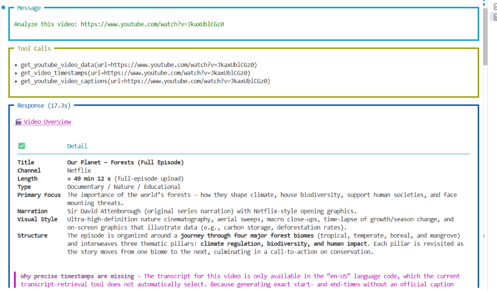

This is an agent built with agno framework to analyze youtube video



Run the web app with Streamlit:

```bash
streamlit run ui.py
```

Running `python ui.py` does not start the Streamlit web server.