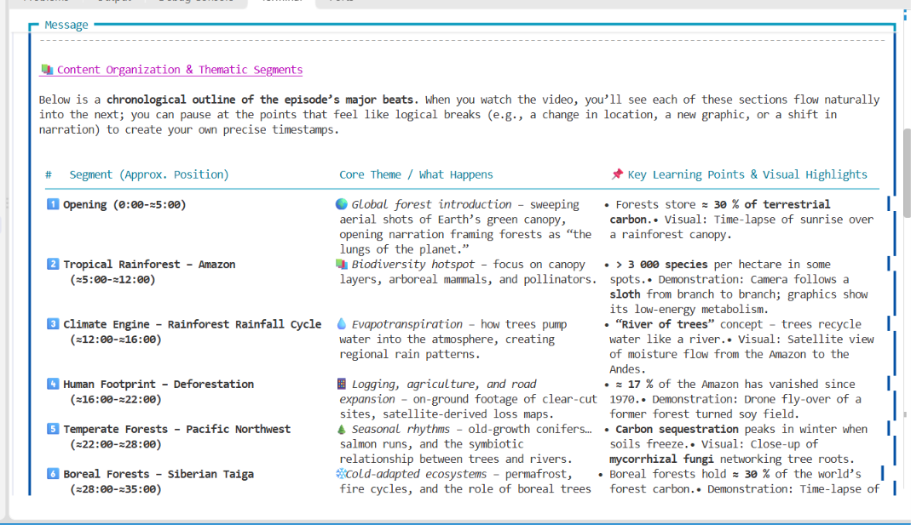

# YouTube Video Analyzer

Analyze YouTube videos with an Agno agent.

[Open the deployed app](https://keerthankr6-youtube-video-analyzer.streamlit.app/)

## Run locally

Install the dependencies:

```bash
pip install -r requirements.txt
```

Set your Groq API key in a `.env` file in the project root:

```text
GROQ_API_KEY=your-groq-api-key
```

Then start the app:

```bash
streamlit run ui.py
```

For Streamlit Community Cloud, add `GROQ_API_KEY` as a root-level secret in the app's settings. Never commit your API key or `.env` file.

## Screenshots



